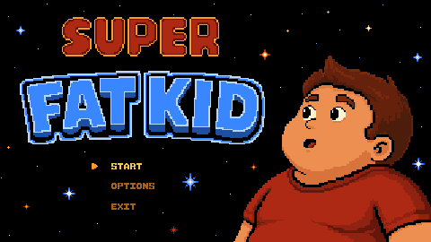
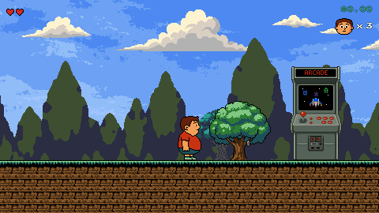

# Super Fat Kid

A work-in-progress 2D pixel-art action platformer built in **Godot 4.4.1** with **GDScript**. Explore outdoor and sewer levels, fight enemies, discover upgrades, and play arcade minigames along the way.

This repository is a portfolio snapshot of an actively developed solo game. It is shared for job applications and code review; it is not a finished release.

## Gameplay

- Running, jumping, kicking, and a fart-powered double jump.
- Unlockable wall jumping, crouching, and blaster abilities.
- Health, lives, stamina, gas, pickups, chests, and persistent progression.
- Multiple campaign levels, enemy behaviors, hazards, and a boss encounter.
- In-game arcade minigames: Alien Commander and Snack Kid Superstar.
- A 480 x 270 pixel-art viewport, animated sprites, original music and sound effects.

## Run the project

1. Download or clone this repository.
2. Open **Godot 4.4.1**, choose **Import**, and select `project.godot`.
3. Allow Godot to finish importing assets, then press **F5** to run the title screen.
4. Choose **Start** to begin the campaign. To inspect a particular level, open its scene under `scenes/levels/` and press **F6**.

No separate package installation is required. Some abilities are unlocked through progression.

### Keyboard controls

- **A / D** or **Left / Right**: move.
- **Space**: jump; jump again for the double jump once unlocked.
- **Shift**: run once unlocked.
- **E**: kick; **F**: fire the blaster once unlocked.
- **S / Down**: crouch once unlocked.
- **Esc**: pause.

### Gamepad controls

Xbox labels are listed first, followed by PlayStation equivalents.

- **Left stick / D-pad**: move and navigate menus.
- **A / Cross (bottom face button)**: jump; press again for the double jump once unlocked.
- **RT / R2**: run once unlocked.
- **X / Square (left face button)**: kick.
- **RB / R1**: fire the blaster once unlocked.
- **Left stick down / D-pad Down**: crouch once unlocked.
- **D-pad Up / left stick up**: enter an arcade cabinet when nearby and carrying a quarter.
- **Menu / Start / Options**: pause.
- **A / Cross** or **X / Square**: confirm title-screen selections; **B / Circle**: back from title-screen options.

Abilities that require upgrades follow the same progression as keyboard controls. Arcade minigames have their own controls, shown in the cabinet interface.

## Explore the code

- `scripts/player/`: player movement, combat, and ability helpers.
- `scripts/enemies/`: enemy behavior and attacks.
- `scripts/progression/` and `resources/progression/`: campaign progression and upgrade rules.
- `scripts/ui/` and `scenes/ui/`: HUD, title screen, and transitions.
- `scenes/levels/`: campaign levels.
- `assets/minigames/`: arcade games and their supporting assets and scripts.
- `scripts/tests/` and minigame `tests/` folders: development checks and playtest tools.

## Development and authorship

Created by **Stephen Jolley**. Artwork, music, and sound effects are created manually by Stephen, except for some AI-generated assets used as temporary placeholders. AI assistance is used for coding during development. This is an ongoing learning and development project.

Features, balance, level layouts, and presentation are still evolving. Development scenes and notes are included; not every path has been verified as a finished player experience.

## About this snapshot

This is a separate publishing copy of the working project. The title screen is configured as its startup scene for reviewers. Editor caches, local AI/editor settings, and machine-specific export paths are excluded. Godot `.import` settings and `.uid` sidecars are retained so asset settings and references can be reconstructed on another computer.

No reuse license is granted by this repository; it is published for portfolio review.
